

  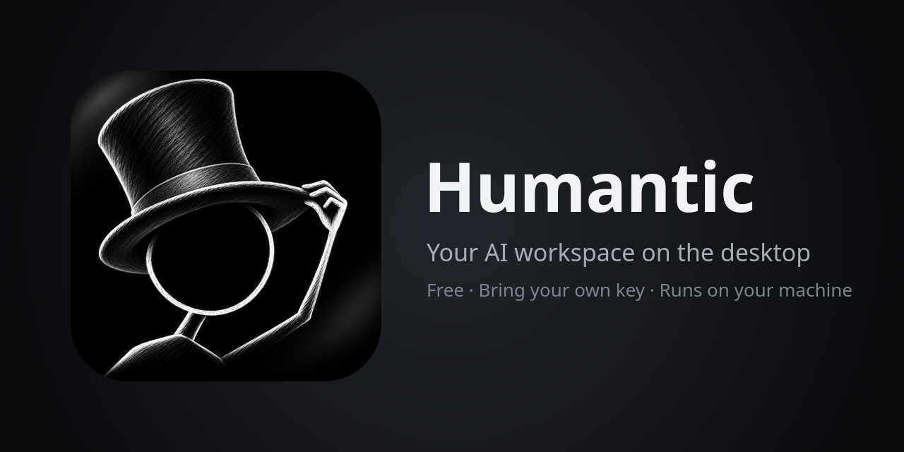

  <b>English</b> · <a href="README.th.md">ภาษาไทย</a>

  
  
  
  
  

  <b>Humantic</b> is a free desktop app for working with AI. 
  <b>Master</b> is an assistant that remembers you and keeps an eye on all your projects. 
  <b>Project chats</b> read your code and propose changes, and nothing changes until you approve it. 
  You bring your own model key. Your chats, memory and keys stay on your computer.

  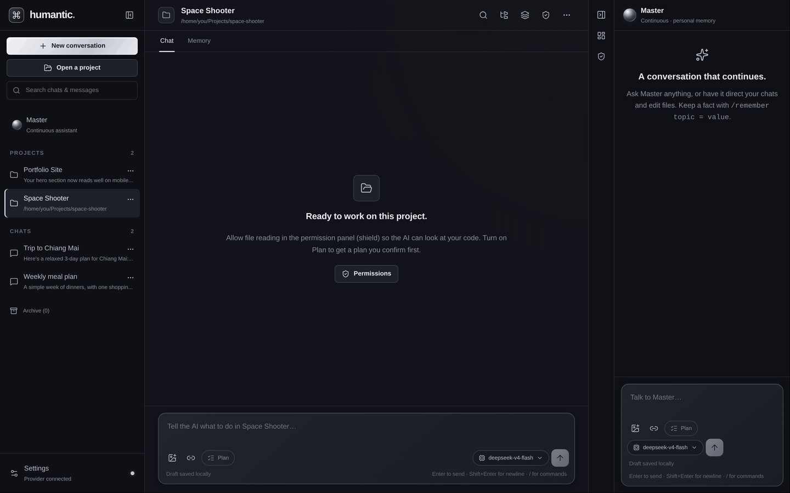
   A project chat looks through the code, explains the bug, and proposes a two-file fix that waits for your review.

  <a href="#features">Features</a> ·
  <a href="#providers">Providers</a> ·
  <a href="#privacy">Privacy</a> ·
  <a href="#download">Download</a> ·
  <a href="#getting-started">Getting started</a> ·
  <a href="#faq">FAQ</a>

## Why Humantic

<table>
  <tr>
    <td width="33%" valign="top">
      <h3>🧠 It remembers</h3>
      Master keeps a long-term memory that never resets by itself. Each project keeps its own map, notes and work log, which you can read and edit.
    </td>
    <td width="33%" valign="top">
      <h3>✅ You stay in control</h3>
      File changes and commands from project chats wait for your approval. You can see every file the AI read and every step it took.
    </td>
    <td width="33%" valign="top">
      <h3>🔑 Your key, your machine</h3>
      Requests go straight from the app to the provider you choose. There is no Humantic server in between, and the app is free.
    </td>
  </tr>
</table>

## Features

### Project chats that read code and propose changes

Open a folder and ask for what you want. The chat searches the project and reads the files it needs. Then it **proposes** edits, new files and commands. You get a diff for each file and can apply or reject each one. Each set of changes also gets a short review summary that says what changed and why.

  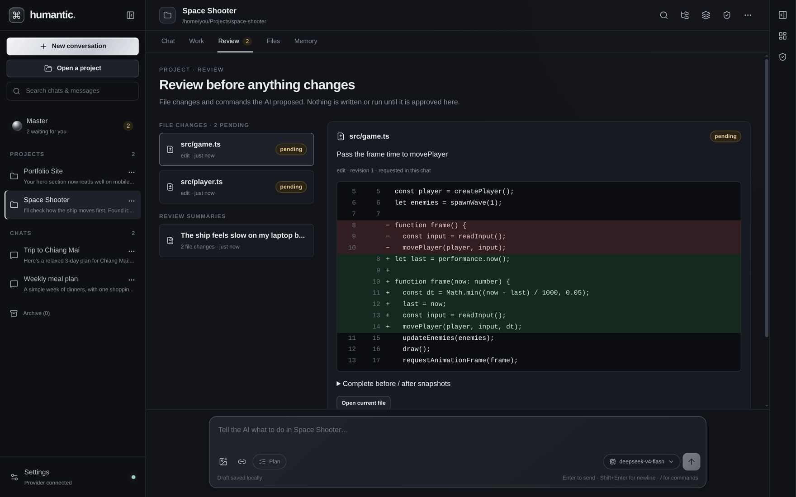
   Review: nothing is written or run until you approve it.

### Plan first, then build

Press **Plan** for bigger jobs. You get a plan document with the goal, the steps, the risks and, when it helps, a small visual drawn by the AI. You can comment on any step, ask for changes, or confirm it. Confirming starts the work, and every file change still comes to you for review.

  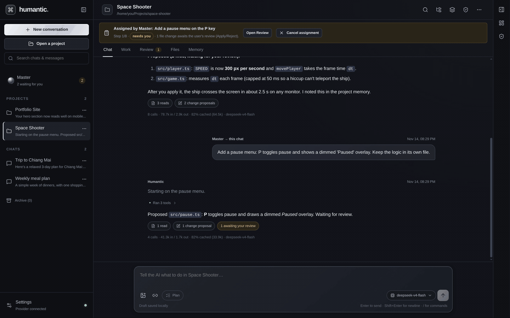
   Plan mode: the plan opens in its own tab, with a visual of the boss arena.

### Master: one assistant across everything

Master lives on the right side of the window, and you can also open it in the center. It remembers you between sessions and knows your chats and projects. It can tell you where things stand, or hand work to a project chat as an **assignment** and follow it until it's done.

  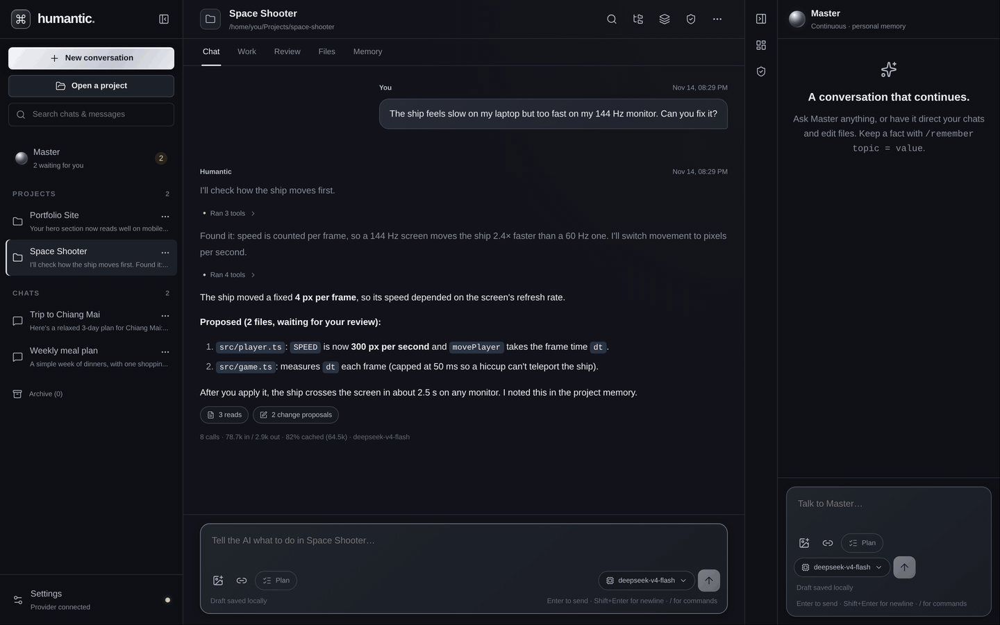
   You ask Master, Master assigns the work to the project chat, and you watch it happen.

<table>
  <tr>
    <td width="50%" valign="top">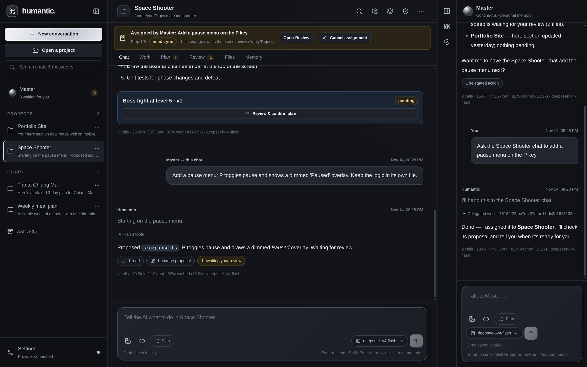
The project chat shows that the work came from Master and what "done" means.
</td>
    <td width="50%" valign="top">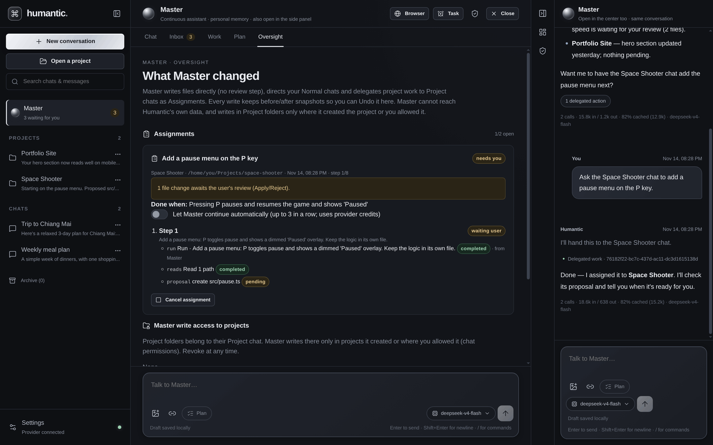
Oversight: every assignment and every file Master changed. You can undo any of Master's writes.
</td>
  </tr>
</table>

### Project memory you can read

Each project keeps its memory in a `.humantic/` folder inside the project: a **project map**, short **notes** about how things work, and a **daily log** of what was done. The AI reads it before it starts, so it doesn't have to relearn your project every time. You can read, edit or delete anything on the Memory page.

<table>
  <tr>
    <td width="50%" valign="top">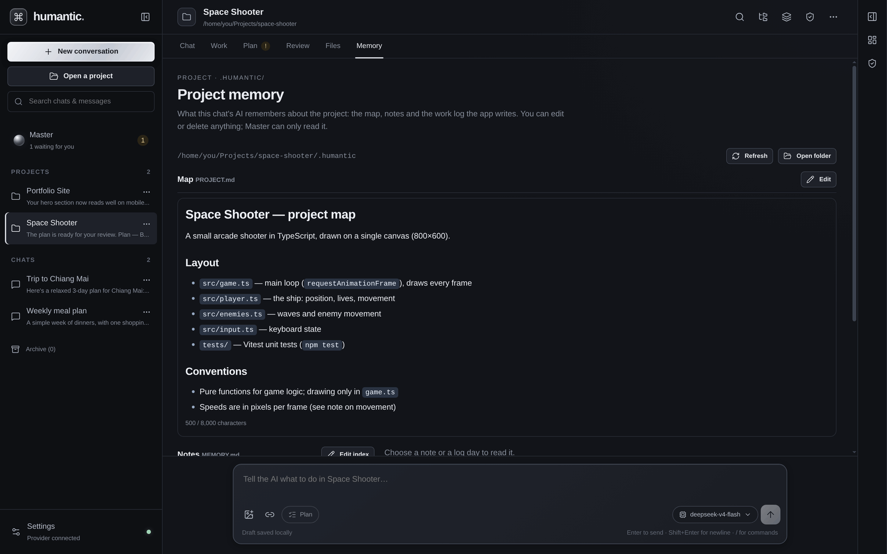
The project map, written by the AI and editable by you.
</td>
    <td width="50%" valign="top">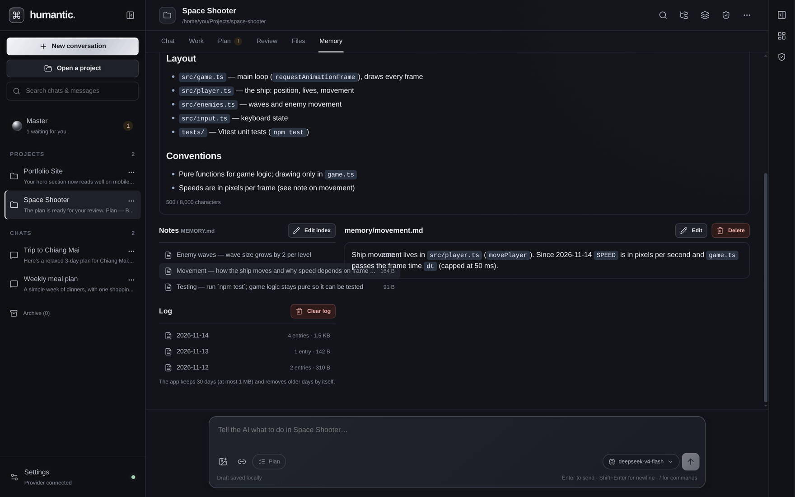
Notes the AI keeps about how the project works.
</td>
  </tr>
</table>

### See exactly what the AI did

The **Work** tab is a live timeline of every run: the files it read, what it searched for, what it proposed and the commands it ran, each with its result.

  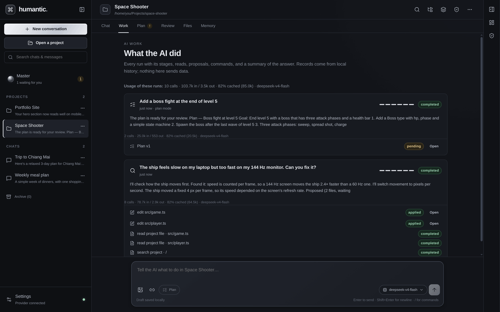

### Search the web and browse

Master and project chats can search the web and read the pages they find. Answers come with a list of sources, each marked **read** or **search result only**. You can search through the built-in browser (Google, Bing or DuckDuckGo) or with an API key (Tavily, Brave, Exa or SearXNG). Master also has its own browser: you can watch it, take over, or sign in for it.

<table>
  <tr>
    <td width="50%" valign="top">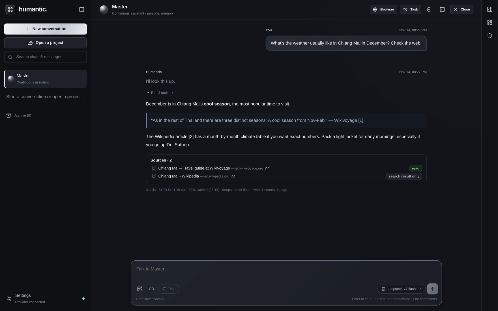
Answers quote the pages they read and list every source.
</td>
    <td width="50%" valign="top">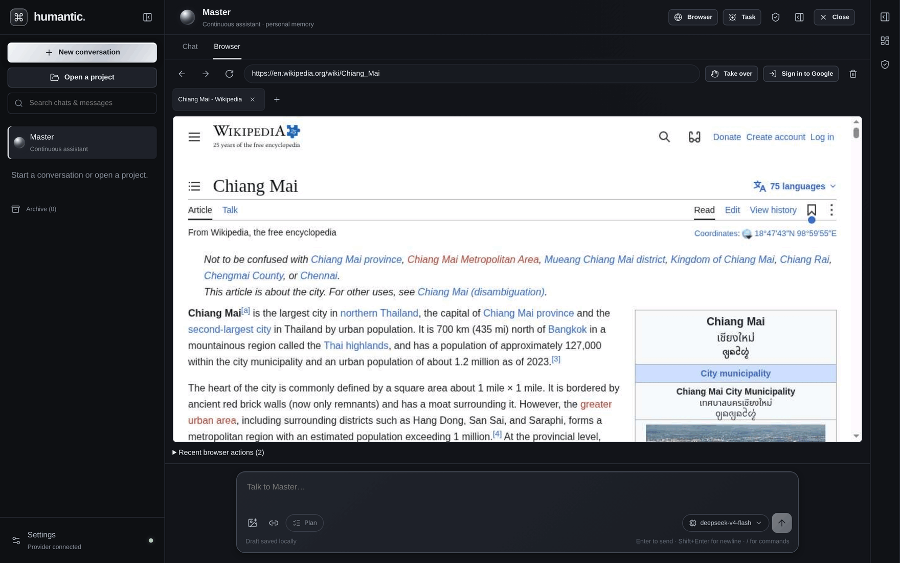
Master's browser. Page shown: Wikipedia, CC BY-SA.
</td>
  </tr>
</table>

### Master notices how you feel

Before it answers, Master briefly checks how your message comes across, for example stressed, curious or in a hurry, and adjusts its tone. A small card above the answer shows this, with 20 gauges and anything that is still unclear. It is on by default and you can turn it off in **Settings → Feelings**. It only applies to Master.

  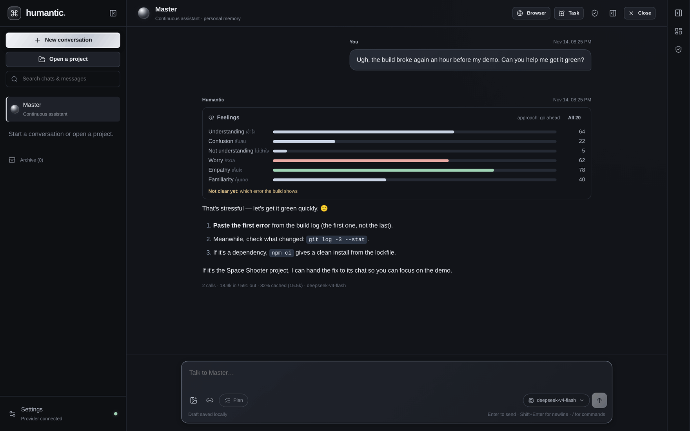

### Connect tools with MCP

Add as many [MCP](https://modelcontextprotocol.io) servers as you like, either local commands or remote URLs. The app also lists **34 ready-made servers**, such as Google Maps, Context7, Notion, Linear, GitHub, Sentry, Supabase, Stripe, Figma and Playwright. Nothing on the list is added or turned on by itself: pick one, check the form, then add it. Local servers ask before their command runs, and every tool call waits for your review.

  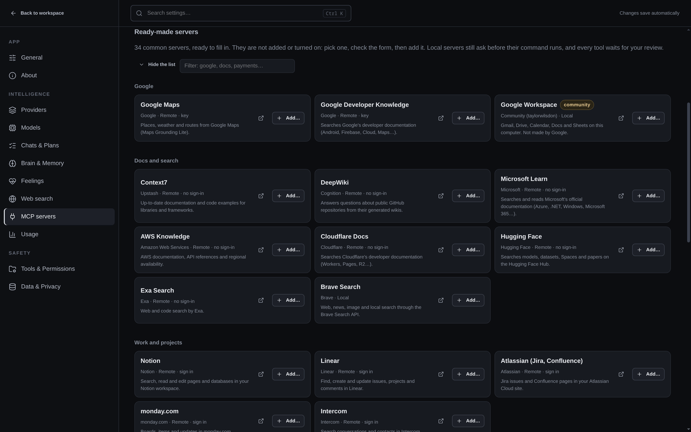

### Know what it costs

Every answer shows its token count and how much of the prompt came from the provider's cache. The **Usage** page adds up tokens by model and by day, week or month, and shows the heaviest runs. If you enter your provider's prices, it also estimates the cost. Prompts are built so providers can cache them, which makes long chats cheaper.

  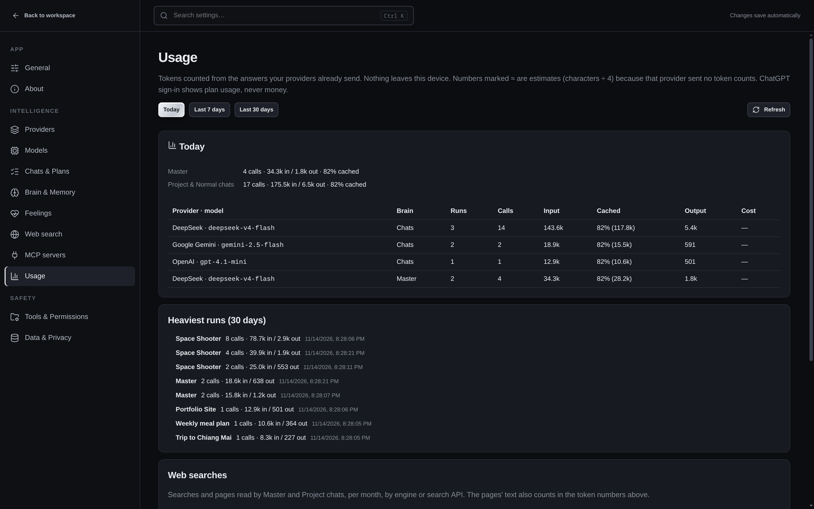

## Providers

Use one provider or many, and pick a different model for each chat.

<table>
  <tr>
    <td width="50%" valign="top">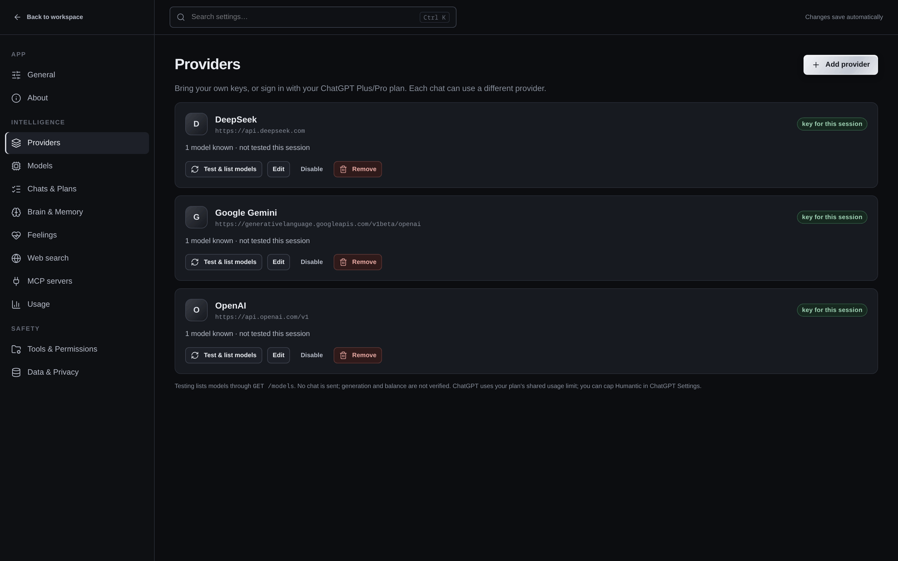</td>
    <td width="50%" valign="top">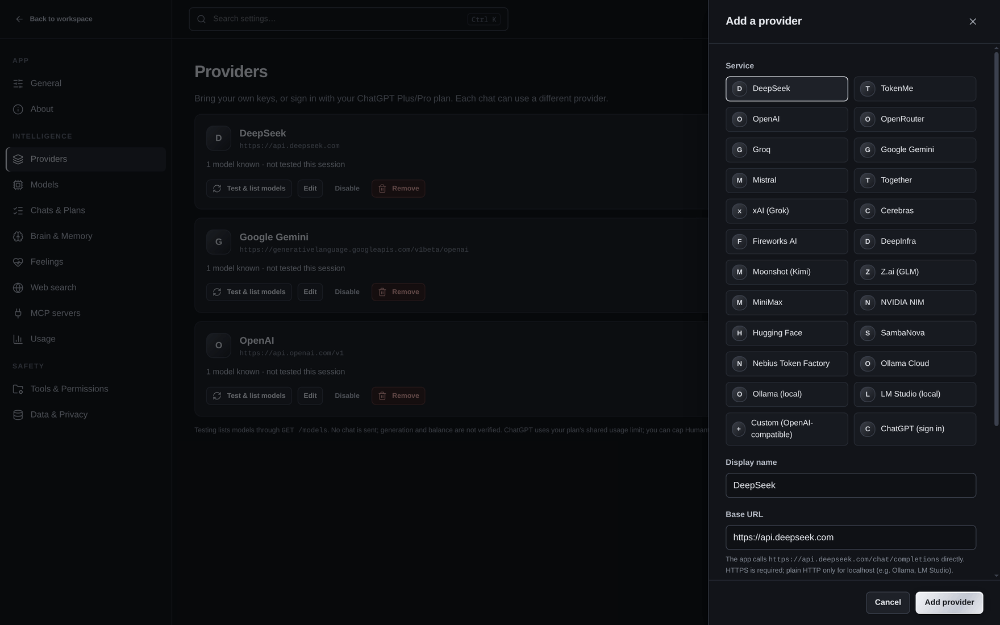</td>
  </tr>
</table>

| Hosted providers | | | |
| --- | --- | --- | --- |
| DeepSeek | OpenAI | Google Gemini | OpenRouter |
| Groq | Mistral | Together | xAI (Grok) |
| Cerebras | Fireworks AI | DeepInfra | Moonshot (Kimi) |
| Z.ai (GLM) | MiniMax | NVIDIA NIM | Hugging Face |
| SambaNova | Nebius Token Factory | Ollama Cloud | TokenMe |

- **On your computer:** Ollama and LM Studio.
- **Anything else:** any OpenAI-compatible API.
- **No API key?** Sign in with your ChatGPT plan.

## Privacy

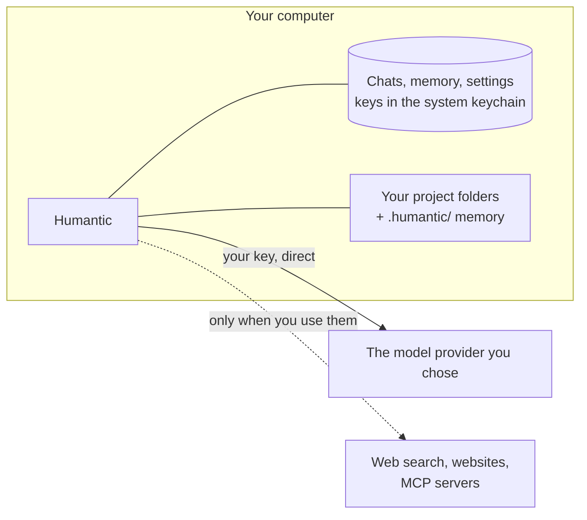

- Chats, memory and keys are stored only on your computer. Keys are encrypted with your system keychain when one is available.
- Requests go straight to the provider you chose. There is no Humantic server or account in between.
- The provider receives what you send it, including the parts of files the AI reads to answer you.
- You pay your provider directly for what you use. Humantic itself is free.

## Download

> **Coming soon.** The first public release isn't out yet. When it is, the installers will be on the **Releases** page of this repository.

| System | File |
| --- | --- |
| Windows 10/11 (x64) | `Humantic-<version>-windows-x64-setup.exe` |
| Linux (x64) | `Humantic-<version>-linux-x86_64.AppImage` |

Humantic never updates itself. You download each new version from this page.

## Getting started

<table>
  <tr>
    <td width="33%" valign="top">
      <h4>1. Install</h4>
      Run the installer on Windows. On Linux, make the AppImage executable and open it.
    </td>
    <td width="33%" valign="top">
      <h4>2. Add a provider</h4>
      Go to <b>Settings → Providers → Add provider</b>, choose your provider and paste your key. Or sign in with ChatGPT.
    </td>
    <td width="33%" valign="top">
      <h4>3. Start working</h4>
      Talk to <b>Master</b> on the right, start a <b>New conversation</b>, or click <b>Open a project</b> to work in a folder.
    </td>
  </tr>
</table>

## FAQ

<b>Is it really free?</b>

Yes. Humantic costs nothing. You pay your model provider for what you use, at their prices. If you run a local model with Ollama or LM Studio, that costs nothing either.

<b>Can the AI change my files without asking?</b>

Project chats can't. Every file change and command they propose waits on the Review tab until you apply or reject it.

Master can write files directly. In project folders, it writes only in projects it created or where you allowed it, and you can take that permission back at any time. Every write Master makes keeps a before/after snapshot, so you can undo it on the Oversight tab.

<b>Is my code uploaded anywhere?</b>

Only to the model provider you chose, and only the parts the AI reads to do the job. It's the same as pasting code into a chat yourself. Nothing goes to a Humantic server, because there isn't one.

<b>Which model should I use?</b>

Models that support tool calling work best, because chats use tools to read files and propose changes. You might use a cheap, fast model for everyday chats and a stronger one for big project work. Each chat can use a different model.

<b>Where is the project memory kept? Can I delete it?</b>

In a `.humantic/` folder inside each project. It holds plain Markdown files: `PROJECT.md`, `MEMORY.md`, a `memory/` folder and a daily `log/`. You can open, edit or delete them on the Memory page or in any text editor.

<b>Can I turn the feelings card off?</b>

Yes, in <b>Settings → Feelings</b>. It only affects Master. When it's on, it adds one small model call per message, and that call appears in your usage.

<b>Is there a macOS version?</b>

Not yet. The first release is for Windows (x64) and Linux (x64).

<b>Is the source code available?</b>

No. Humantic is free to use, but the source code isn't public. See the license below.

## License

Free to use for personal and work purposes. The source code is not public, and you may not copy, modify, reverse engineer or redistribute the app. Download it only from this page. See [LICENSE.txt](LICENSE.txt).

The screenshots show demo projects with made-up data. The browser screenshot shows a Wikipedia page (CC BY-SA 4.0).

© 2026 The Humantic authors
