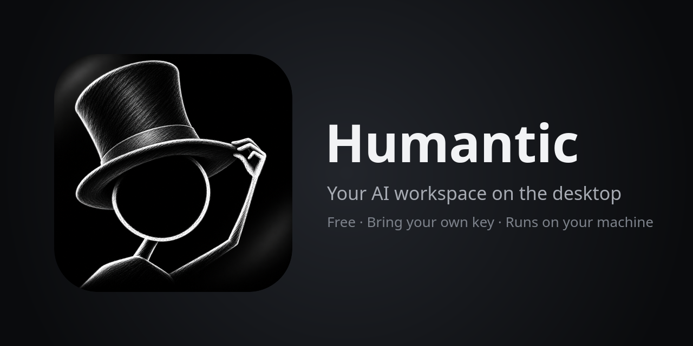
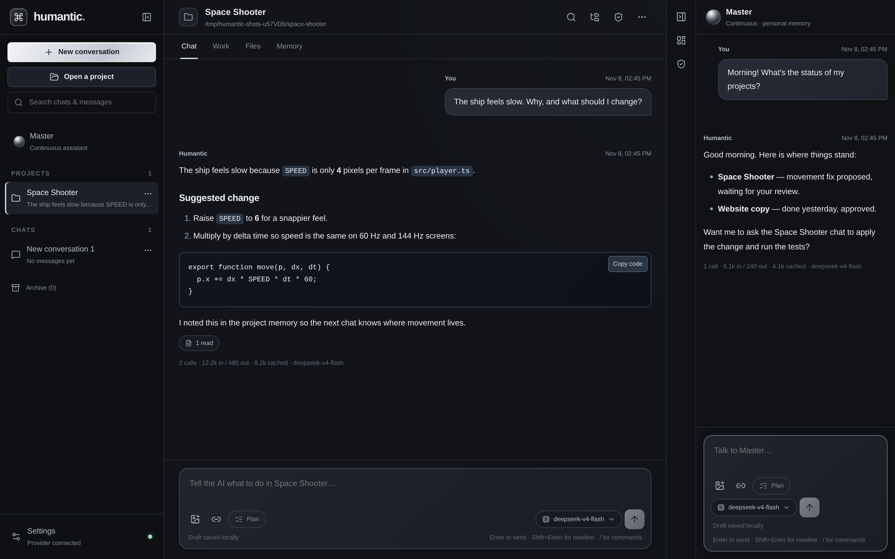
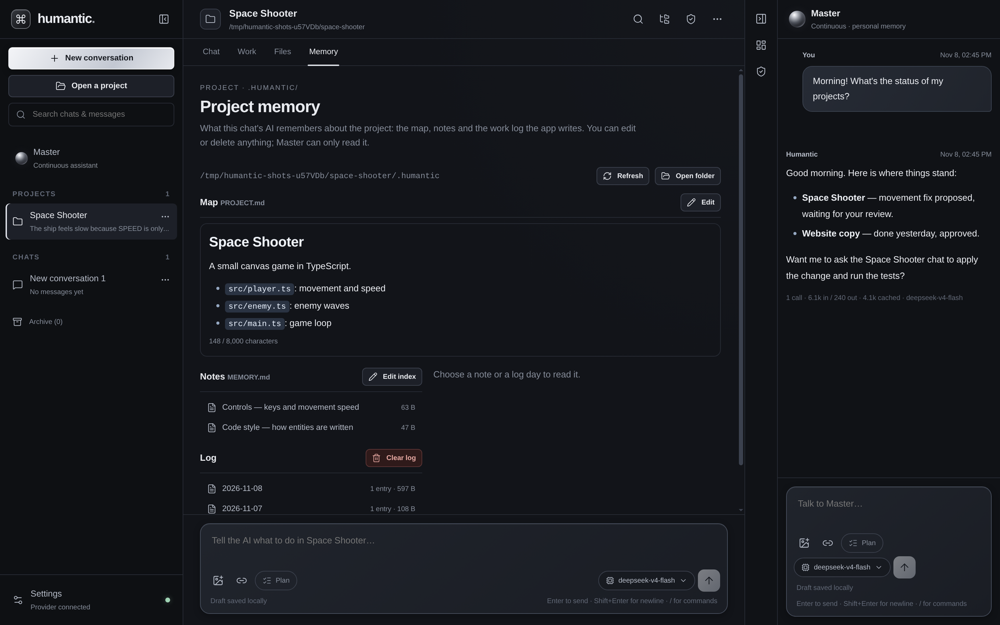
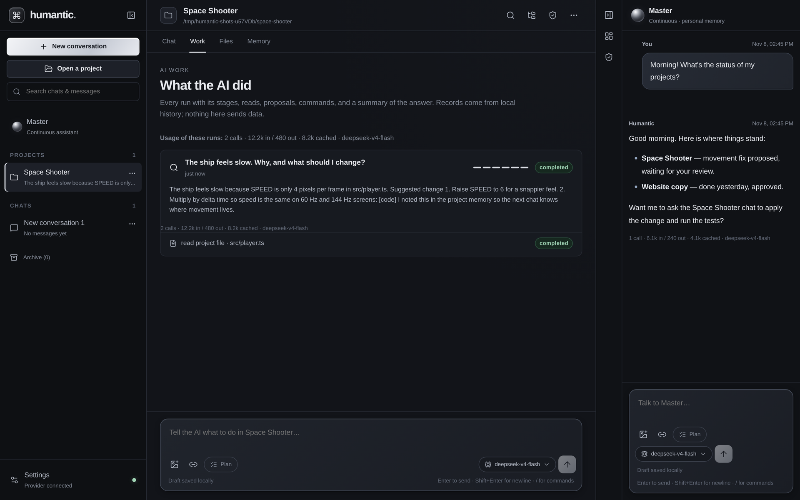
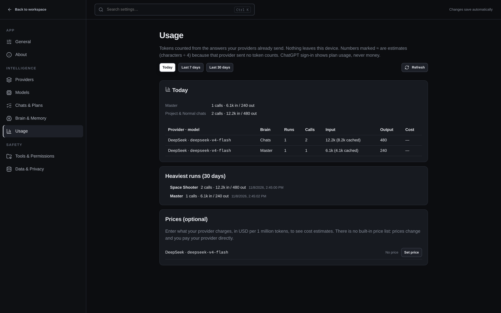

  

  
  
  
  

**Humantic** is a free desktop app for working with AI. A continuous assistant, **Master**, remembers you between sessions and keeps track of your projects. **Project chats** read your code, propose changes for you to review, and keep their own notes about each project. You bring your own model key, and everything stays on your computer.

**Humantic** แอปเดสก์ท็อปสำหรับทำงานกับ AI ใช้ฟรี มี **Master** เป็นผู้ช่วยที่จำคุณได้ต่อเนื่องและคอยดูแลทุกโปรเจกต์ ส่วน **แชตโปรเจกต์** อ่านโค้ด เสนอการแก้ไขให้คุณตรวจก่อน และจดความจำของแต่ละโปรเจกต์ไว้เอง ใช้ key ของคุณเอง และข้อมูลทั้งหมดอยู่ในเครื่องคุณ

  

## Features

- **Master, your continuous assistant**: it has a long-term memory that never resets on its own. It can hand work to your chats, check the result and tell you where things stand. It can also read and write files on your computer (every write can be undone) and browse the web.
- **Project chats**: open a folder and the AI reads the files it needs. It proposes changes and commands, and nothing is applied until you approve it. Plan mode gives you a plan to review first.
- **Project memory**: each project keeps a map, notes and a daily work log in `.humantic/`. You can read, edit or delete them on the Memory page.
- **See what the AI did**: the Work tab lists every file read, proposal and command for each run.
- **Token usage**: shown under every answer, per run, and per day, week or month. Enter your provider's prices if you want cost estimates.
- **Any provider**: DeepSeek, OpenAI, OpenRouter, Groq, Google Gemini, Mistral, Together, TokenMe, any OpenAI-compatible API (including local Ollama or LM Studio), or sign in with your ChatGPT plan. You can use a different model in each chat.

<table>
  <tr>
    <td width="50%">
Project memory: map, notes and work log
</td>
    <td width="50%">
Work: what the AI read and did in each run
</td>
  </tr>
  <tr>
    <td colspan="2">
Usage: tokens by model and the heaviest runs
</td>
  </tr>
</table>

## Download

The first public release is coming soon. When it's out, installers will be on the **[Releases](../../releases)** page:

| System | File |
| --- | --- |
| Windows 10/11 (x64) | `Humantic-<version>-windows-x64-setup.exe` |
| Linux (x64) | `Humantic-<version>-linux-x86_64.AppImage` |

The app checks for new versions and tells you when one is ready. It never updates itself without asking.

## Getting started

1. Install and open Humantic.
2. Go to **Settings → Providers → Add provider**, choose your provider and paste your API key, or sign in with ChatGPT.
3. Talk to **Master** on the right, or click **Open a project** to work in a folder.

## Privacy

- Your chats, memory and keys are stored only on your computer. Keys are encrypted with your system keychain when one is available.
- Requests go straight from the app to the provider you chose. There is no Humantic server in between.
- You pay your provider directly for what you use. Humantic itself is free.

## License

Free to use for personal and work purposes. The source code is not public, and copying, modifying, reverse engineering or redistributing the app is not allowed. Download it only from this page. See [LICENSE.txt](LICENSE.txt).

© 2026 The Humantic authors
