

  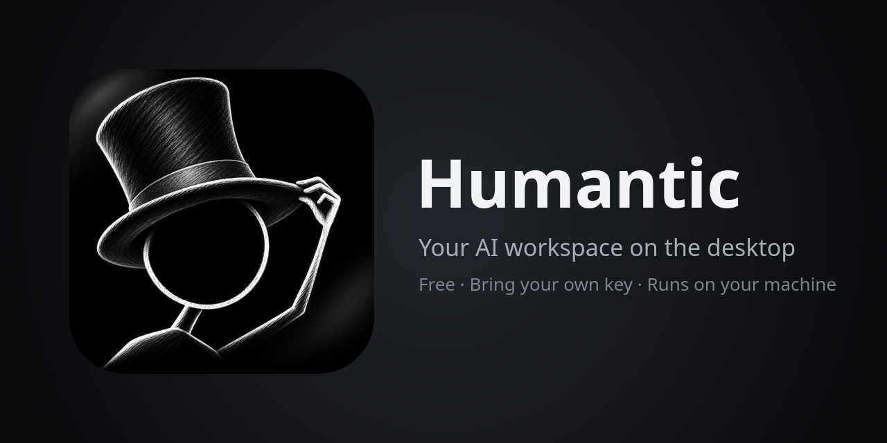

  <a href="README.md">English</a> · <b>ภาษาไทย</b>

  
  
  
  
  

  <b>Humantic</b> แอปเดสก์ท็อปสำหรับทำงานกับ AI ใช้ฟรี 
  <b>Master</b> ผู้ช่วยที่จำคุณได้ และคอยดูแลทุกโปรเจกต์ของคุณ 
  <b>แชตโปรเจกต์</b> อ่านโค้ดและเสนอการแก้ไข โดยไม่มีอะไรเปลี่ยนจนกว่าคุณจะอนุมัติ 
  ใช้ key ของคุณเอง แชต ความจำ และ key ทั้งหมดอยู่ในเครื่องคุณ

  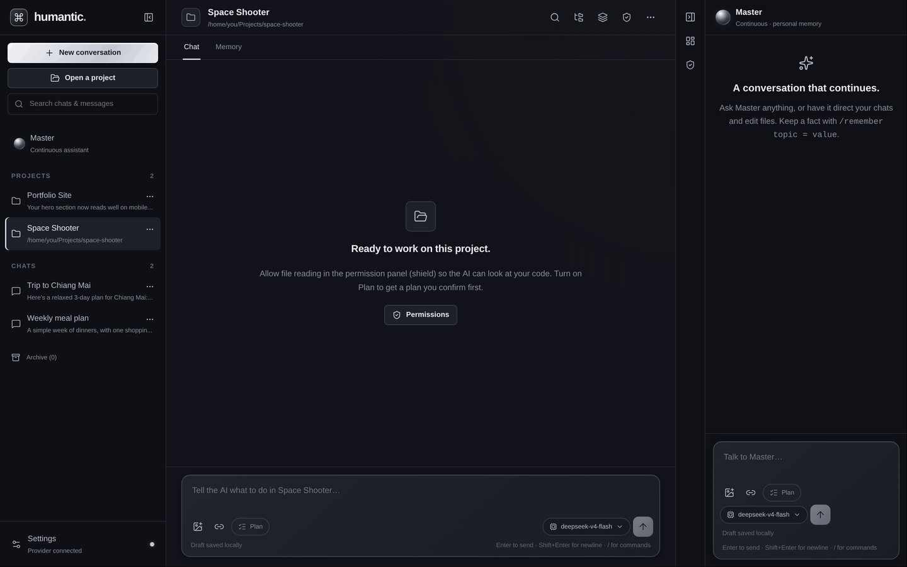
   แชตโปรเจกต์ไล่ดูโค้ด อธิบายต้นเหตุของบั๊ก และเสนอการแก้ 2 ไฟล์ที่รอคุณตรวจ

  <a href="#ความสามารถ">ความสามารถ</a> ·
  <a href="#ผู้ให้บริการโมเดล">ผู้ให้บริการโมเดล</a> ·
  <a href="#ความเป็นส่วนตัว">ความเป็นส่วนตัว</a> ·
  <a href="#ดาวน์โหลด">ดาวน์โหลด</a> ·
  <a href="#เริ่มใช้งาน">เริ่มใช้งาน</a> ·
  <a href="#คำถามที่พบบ่อย">คำถามที่พบบ่อย</a>

## ทำไมต้อง Humantic

<table>
  <tr>
    <td width="33%" valign="top">
      <h3>🧠 จำได้จริง</h3>
      Master มีความจำระยะยาวที่ไม่ถูกล้างเอง แต่ละโปรเจกต์ก็มีแผนที่ โน้ต และบันทึกการทำงานของตัวเอง ซึ่งคุณเปิดอ่านและแก้ได้
    </td>
    <td width="33%" valign="top">
      <h3>✅ คุณเป็นคนตัดสิน</h3>
      การแก้ไฟล์และคำสั่งจากแชตโปรเจกต์ต้องรอคุณอนุมัติก่อน และคุณดูได้ทุกไฟล์ที่ AI อ่านและทุกขั้นที่มันทำ
    </td>
    <td width="33%" valign="top">
      <h3>🔑 key ของคุณ เครื่องของคุณ</h3>
      แอปส่งคำขอตรงไปยังผู้ให้บริการที่คุณเลือก ไม่มีเซิร์ฟเวอร์ของ Humantic คั่นกลาง และใช้ฟรี
    </td>
  </tr>
</table>

## ความสามารถ

### แชตโปรเจกต์ที่อ่านโค้ดและเสนอการแก้ไข

เปิดโฟลเดอร์แล้วบอกสิ่งที่ต้องการ แชตจะค้นในโปรเจกต์และอ่านเฉพาะไฟล์ที่ต้องใช้ จากนั้น**เสนอ**การแก้ไฟล์ ไฟล์ใหม่ และคำสั่งให้คุณ คุณจะเห็น diff ของแต่ละไฟล์ และเลือก apply หรือ reject ได้ทีละรายการ ทุกชุดการแก้ไขมีใบสรุปสั้น ๆ ว่าแก้อะไรและทำไม

  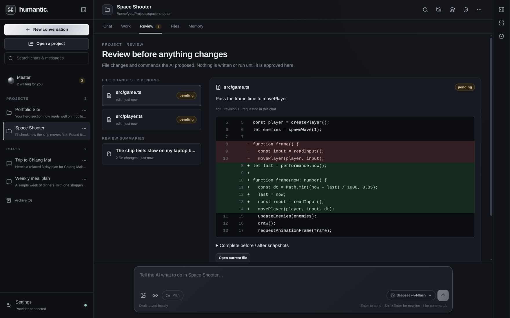
   Review: ไม่มีอะไรถูกเขียนหรือรันจนกว่าคุณจะอนุมัติ

### วางแผนก่อน แล้วค่อยลงมือ

งานใหญ่ให้กด **Plan** คุณจะได้เอกสารแผนที่มีเป้าหมาย ขั้นตอน และความเสี่ยง และถ้าช่วยให้เข้าใจง่ายขึ้น AI จะวาดภาพประกอบให้ด้วย คุณคอมเมนต์ทีละขั้น ขอให้แก้ หรือยืนยันแผนได้ เมื่อยืนยันแล้วงานจะเริ่ม และการแก้ไฟล์ทุกครั้งยังต้องผ่านการตรวจของคุณ

  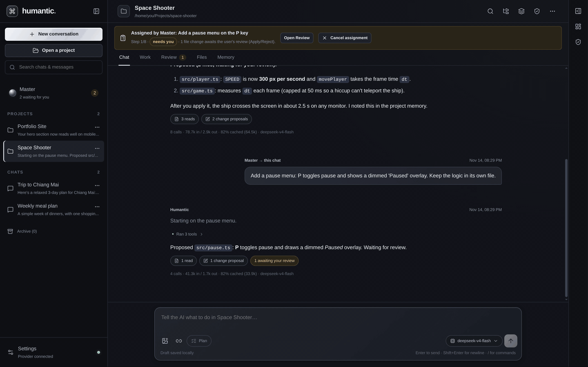
   โหมด Plan: แผนเปิดในแท็บของตัวเอง พร้อมภาพฉากต่อสู้กับบอส

### Master: ผู้ช่วยคนเดียวที่ดูแลทุกอย่าง

Master อยู่ด้านขวาของหน้าต่าง และเปิดไว้ตรงกลางได้ด้วย มันจำคุณได้ข้ามวัน และรู้จักแชตกับโปรเจกต์ทั้งหมดของคุณ ถามได้ว่างานไปถึงไหนแล้ว หรือให้มันส่งงานไปให้แชตโปรเจกต์เป็น**งานมอบหมาย** แล้วคอยติดตามจนงานเสร็จ

  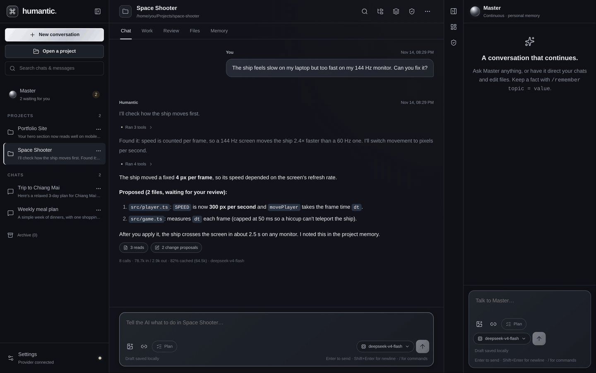
   คุณบอก Master แล้ว Master มอบงานให้แชตโปรเจกต์ คุณดูมันทำงานได้สด ๆ

<table>
  <tr>
    <td width="50%" valign="top">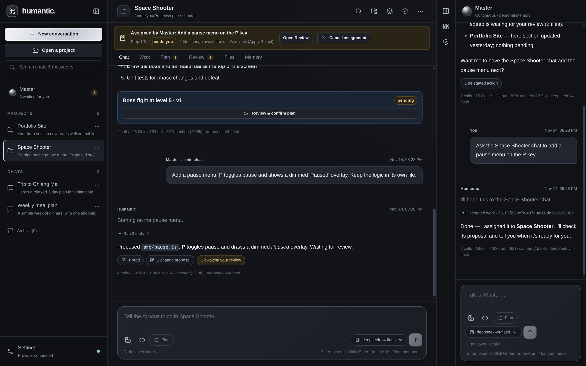
แชตโปรเจกต์บอกว่างานนี้มาจาก Master และแค่ไหนถึงนับว่าเสร็จ
</td>
    <td width="50%" valign="top">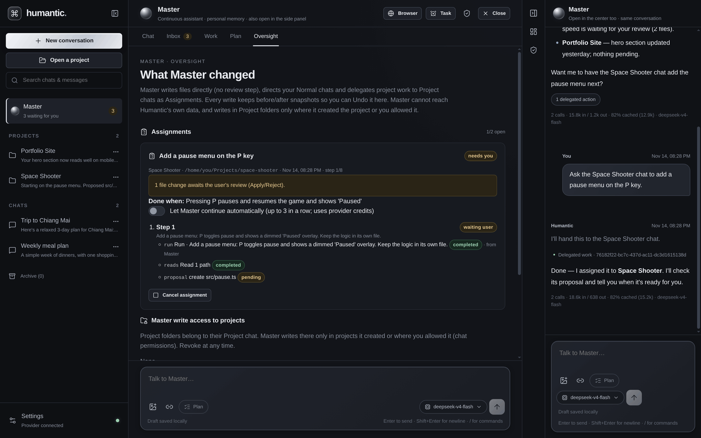
Oversight: งานมอบหมายทั้งหมดและทุกไฟล์ที่ Master แก้ ย้อนกลับการเขียนของ Master ได้ทุกครั้ง
</td>
  </tr>
</table>

### ความจำโปรเจกต์ที่คุณอ่านได้

แต่ละโปรเจกต์เก็บความจำไว้ในโฟลเดอร์ `.humantic/` ภายในโปรเจกต์ ได้แก่**แผนที่โปรเจกต์** **โน้ต**สั้น ๆ ว่าส่วนต่าง ๆ ทำงานอย่างไร และ**บันทึกรายวัน**ว่าทำอะไรไปแล้ว AI อ่านความจำนี้ก่อนเริ่มงาน จึงไม่ต้องเรียนรู้โปรเจกต์ใหม่ทุกครั้ง คุณอ่าน แก้ หรือลบได้ทุกอย่างในหน้า Memory

<table>
  <tr>
    <td width="50%" valign="top">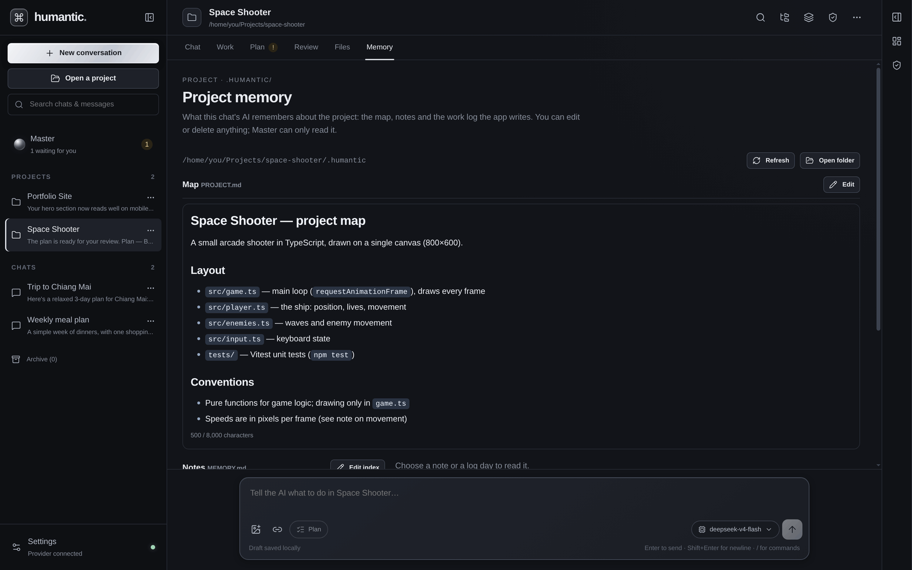
แผนที่โปรเจกต์ AI เป็นคนเขียน คุณแก้ได้
</td>
    <td width="50%" valign="top">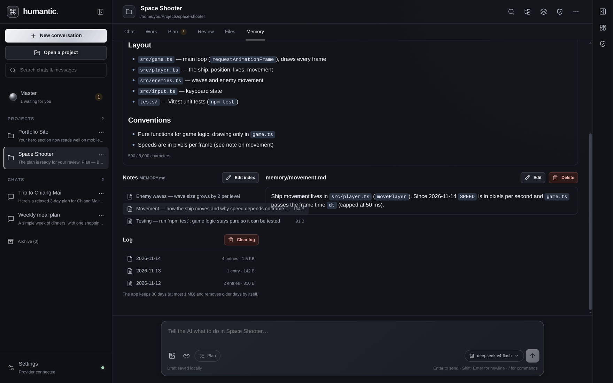
โน้ตที่ AI จดไว้ว่าโปรเจกต์ทำงานอย่างไร
</td>
  </tr>
</table>

### เห็นทุกอย่างที่ AI ทำ

แท็บ **Work** เป็นไทม์ไลน์สดของทุก run ทั้งไฟล์ที่อ่าน สิ่งที่ค้น สิ่งที่เสนอ และคำสั่งที่รัน พร้อมผลของแต่ละขั้น

  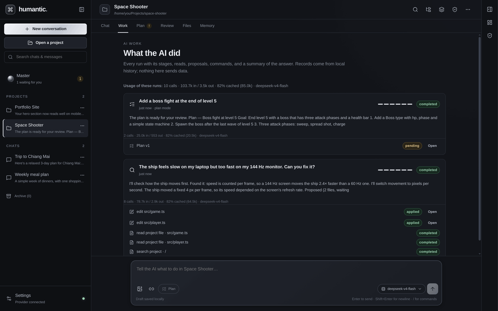

### ค้นเว็บและเปิดเบราว์เซอร์

Master และแชตโปรเจกต์ค้นเว็บและอ่านหน้าที่เจอได้ คำตอบจะมีรายการแหล่งที่มา บอกว่าแหล่งไหน**อ่านแล้ว**และแหล่งไหนเป็น**แค่ผลค้นหา** จะค้นผ่านเบราว์เซอร์ในแอป (Google, Bing หรือ DuckDuckGo) หรือใช้ API key (Tavily, Brave, Exa หรือ SearXNG) ก็ได้ นอกจากนี้ Master มีเบราว์เซอร์ของตัวเอง คุณดูมันทำงาน รับช่วงควบคุมเอง หรือล็อกอินให้มันได้

<table>
  <tr>
    <td width="50%" valign="top">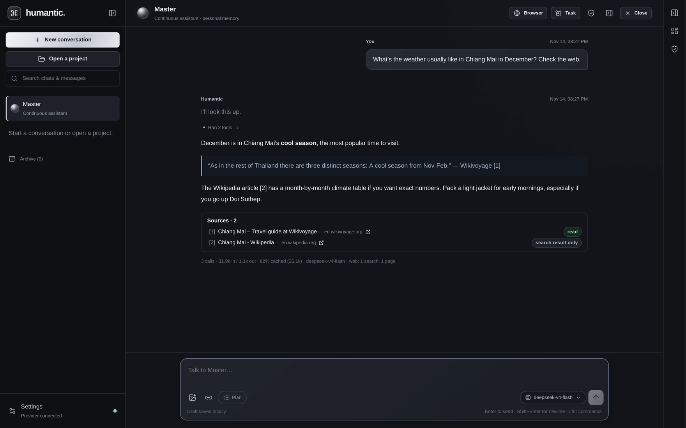
คำตอบยกข้อความจากหน้าที่อ่าน และบอกแหล่งที่มาทุกแหล่ง
</td>
    <td width="50%" valign="top">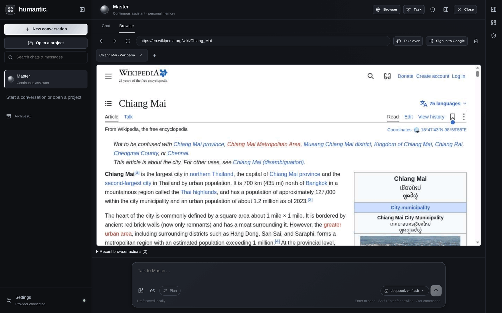
เบราว์เซอร์ของ Master หน้าที่แสดง: Wikipedia, CC BY-SA
</td>
  </tr>
</table>

### Master รับรู้ว่าคุณรู้สึกอย่างไร

ก่อนตอบ Master จะดูสั้น ๆ ว่าข้อความของคุณให้ความรู้สึกแบบไหน เช่น เครียด อยากรู้ หรือรีบ แล้วปรับน้ำเสียงให้เหมาะ การ์ดเล็ก ๆ เหนือคำตอบจะแสดงเกจ 20 ตัว และบอกสิ่งที่ยังไม่ชัด ระบบนี้เปิดไว้เป็นค่าเริ่มต้น และปิดได้ที่ **Settings → Feelings** โดยใช้กับ Master เท่านั้น

  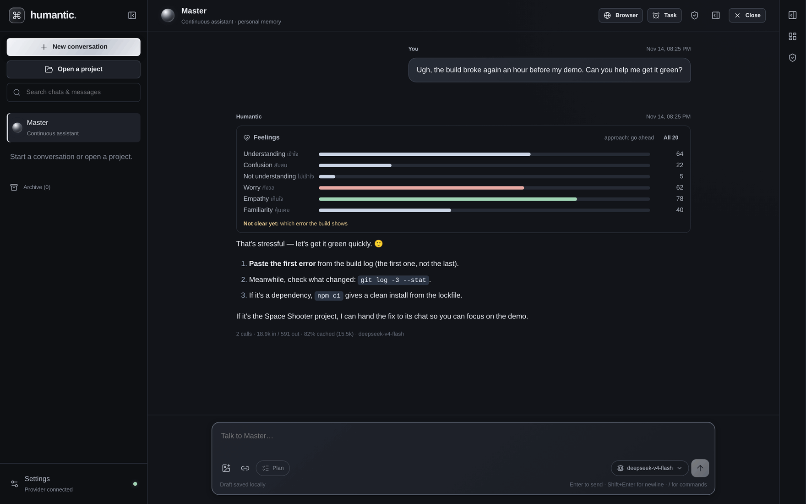

### ต่อเครื่องมือด้วย MCP

เพิ่ม [MCP](https://modelcontextprotocol.io) server ได้ไม่จำกัด จะเป็นคำสั่งในเครื่องหรือ URL ภายนอกก็ได้ ในแอปยังมีรายการ **server สำเร็จรูป 34 ตัว** เช่น Google Maps, Context7, Notion, Linear, GitHub, Sentry, Supabase, Stripe, Figma และ Playwright ไม่มีตัวไหนถูกเพิ่มหรือเปิดเอง คุณเลือก ตรวจฟอร์ม แล้วจึงกดเพิ่ม server ในเครื่องจะถามก่อนรันคำสั่ง และการเรียกเครื่องมือทุกครั้งรอคุณตรวจ

  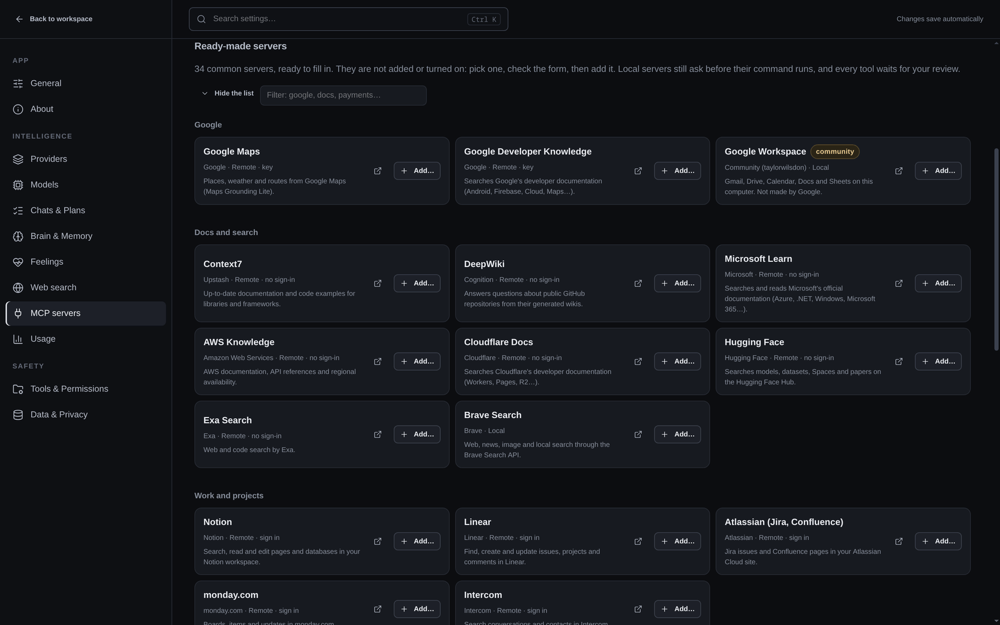

### รู้ว่าใช้ไปเท่าไร

ใต้ทุกคำตอบจะบอกจำนวน token และบอกว่า prompt ส่วนไหนมาจาก cache ของผู้ให้บริการ หน้า **Usage** รวมยอด token แยกตามโมเดล ตามวัน สัปดาห์ หรือเดือน และแสดง run ที่ใช้มากที่สุด ถ้าใส่ราคาของผู้ให้บริการไว้ แอปจะประมาณค่าใช้จ่ายให้ด้วย prompt ถูกจัดให้ผู้ให้บริการ cache ได้ แชตยาว ๆ จึงประหยัดขึ้น

  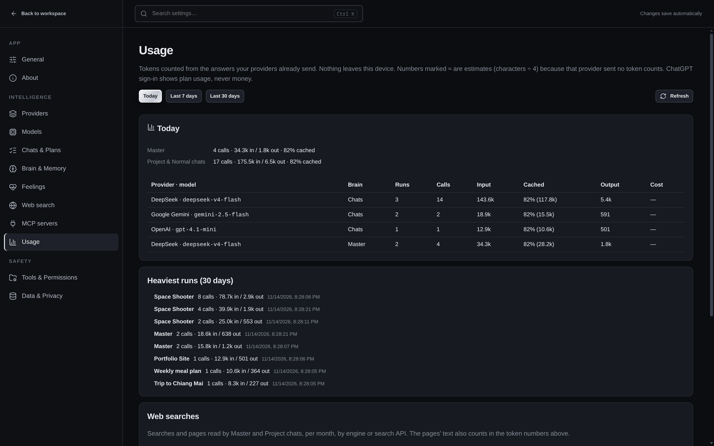

## ผู้ให้บริการโมเดล

ใช้ผู้ให้บริการรายเดียวหรือหลายรายก็ได้ และเลือกโมเดลแยกได้ในแต่ละแชต

<table>
  <tr>
    <td width="50%" valign="top">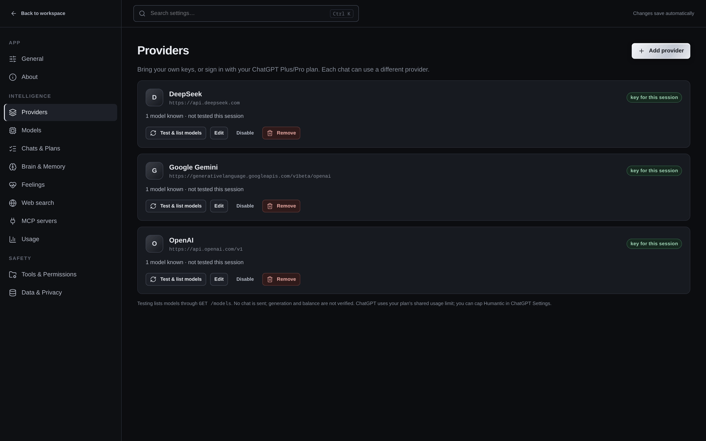</td>
    <td width="50%" valign="top">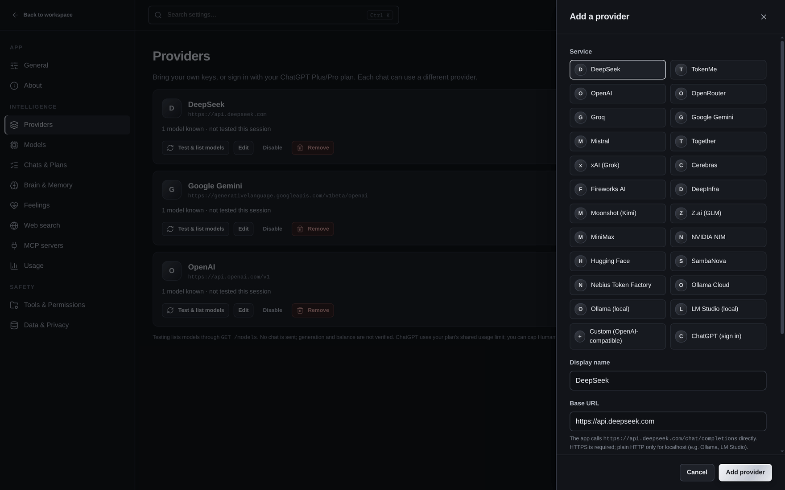</td>
  </tr>
</table>

| ผู้ให้บริการออนไลน์ | | | |
| --- | --- | --- | --- |
| DeepSeek | OpenAI | Google Gemini | OpenRouter |
| Groq | Mistral | Together | xAI (Grok) |
| Cerebras | Fireworks AI | DeepInfra | Moonshot (Kimi) |
| Z.ai (GLM) | MiniMax | NVIDIA NIM | Hugging Face |
| SambaNova | Nebius Token Factory | Ollama Cloud | TokenMe |

- **รันในเครื่อง:** Ollama และ LM Studio
- **รายอื่น:** API ใดก็ได้ที่เข้ากันได้กับ OpenAI
- **ไม่มี API key?** ล็อกอินด้วยแพ็กเกจ ChatGPT ของคุณ

## ความเป็นส่วนตัว

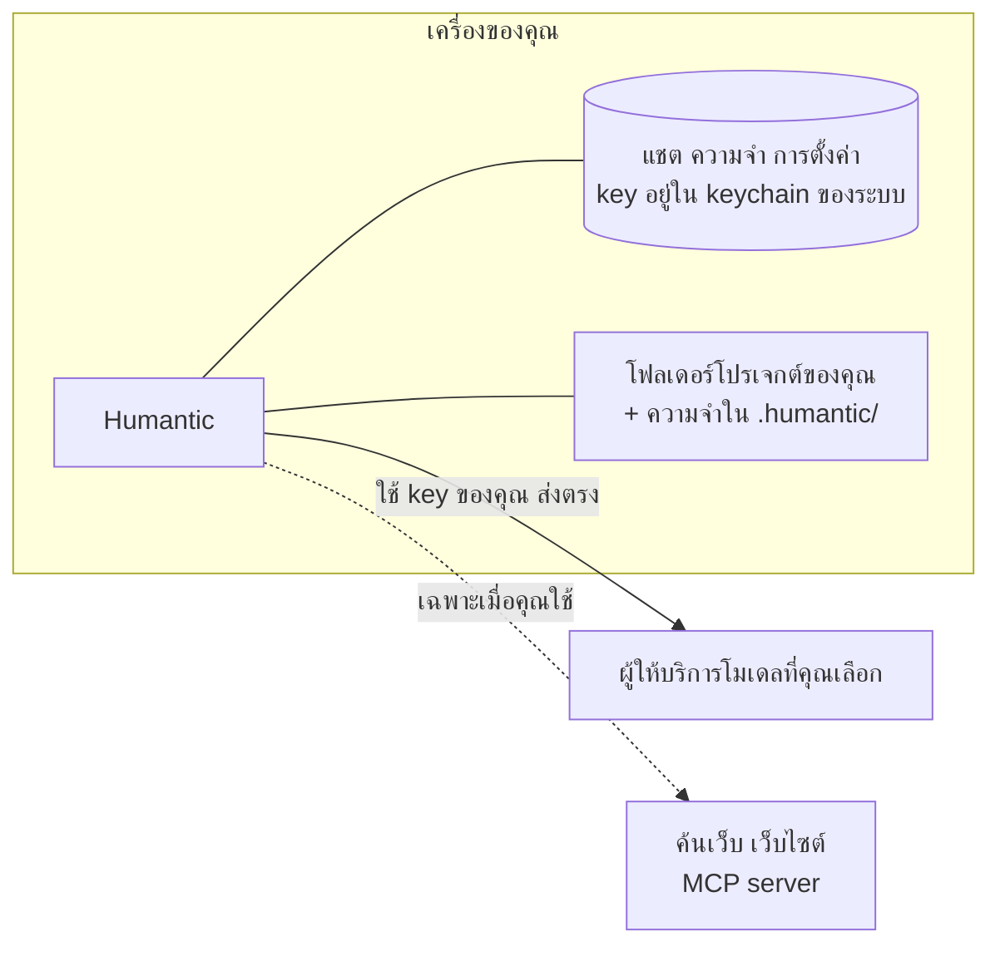

- แชต ความจำ และ key เก็บไว้ในเครื่องคุณเท่านั้น ถ้าระบบมี keychain แอปจะใช้เข้ารหัส key
- แอปส่งคำขอตรงไปยังผู้ให้บริการที่คุณเลือก ไม่มีเซิร์ฟเวอร์หรือบัญชีของ Humantic คั่นกลาง
- ผู้ให้บริการจะได้รับสิ่งที่คุณส่งไป รวมถึงส่วนของไฟล์ที่ AI อ่านเพื่อตอบคุณ
- คุณจ่ายค่าใช้งานให้ผู้ให้บริการโดยตรง ตัว Humantic ใช้ฟรี

## ดาวน์โหลด

> **เร็ว ๆ นี้** ยังไม่มีเวอร์ชันเผยแพร่แรก เมื่อออกแล้ว ตัวติดตั้งจะอยู่ในหน้า **Releases** ของ repository นี้

| ระบบ | ไฟล์ |
| --- | --- |
| Windows 10/11 (x64) | `Humantic-<version>-windows-x64-setup.exe` |
| Linux (x64) | `Humantic-<version>-linux-x86_64.AppImage` |

Humantic ไม่อัปเดตตัวเอง ทุกเวอร์ชันใหม่ให้ดาวน์โหลดจากหน้านี้

## เริ่มใช้งาน

<table>
  <tr>
    <td width="33%" valign="top">
      <h4>1. ติดตั้ง</h4>
      บน Windows ให้รันตัวติดตั้ง บน Linux ให้ตั้งไฟล์ AppImage เป็นไฟล์รันได้ แล้วเปิด
    </td>
    <td width="33%" valign="top">
      <h4>2. เพิ่มผู้ให้บริการ</h4>
      ไปที่ <b>Settings → Providers → Add provider</b> เลือกผู้ให้บริการแล้ววาง key หรือล็อกอินด้วย ChatGPT
    </td>
    <td width="33%" valign="top">
      <h4>3. เริ่มทำงาน</h4>
      คุยกับ <b>Master</b> ทางขวา เริ่ม <b>New conversation</b> หรือกด <b>Open a project</b> เพื่อทำงานในโฟลเดอร์
    </td>
  </tr>
</table>

## คำถามที่พบบ่อย

<b>ฟรีจริงไหม</b>

ฟรีจริง ตัว Humantic ไม่มีค่าใช้จ่าย คุณจ่ายแค่ค่าใช้โมเดลให้ผู้ให้บริการตามราคาของเขา และถ้ารันโมเดลในเครื่องด้วย Ollama หรือ LM Studio ก็ไม่เสียอะไรเลย

<b>AI แก้ไฟล์ของฉันโดยไม่ถามได้ไหม</b>

แชตโปรเจกต์ทำไม่ได้ ทุกการแก้ไฟล์และคำสั่งที่เสนอจะรออยู่ในแท็บ Review จนกว่าคุณจะ apply หรือ reject

Master เขียนไฟล์ได้โดยตรง แต่ในโฟลเดอร์โปรเจกต์จะเขียนได้เฉพาะโปรเจกต์ที่มันสร้างเองหรือที่คุณอนุญาต และคุณถอนสิทธิ์ได้ทุกเมื่อ ทุกครั้งที่ Master เขียนจะเก็บภาพก่อน/หลังไว้ จึงย้อนกลับได้ในแท็บ Oversight

<b>โค้ดของฉันถูกส่งไปไหนบ้าง</b>

ไปที่ผู้ให้บริการโมเดลที่คุณเลือกเท่านั้น และเฉพาะส่วนที่ AI ต้องอ่านเพื่อทำงาน เหมือนกับที่คุณวางโค้ดลงในแชตเอง ไม่มีอะไรไปที่เซิร์ฟเวอร์ของ Humantic เพราะไม่มีเซิร์ฟเวอร์แบบนั้น

<b>ควรใช้โมเดลไหน</b>

โมเดลที่รองรับ tool calling จะทำงานได้ดีที่สุด เพราะแชตใช้เครื่องมือในการอ่านไฟล์และเสนอการแก้ไข อาจใช้โมเดลถูกและเร็วสำหรับแชตทั่วไป และโมเดลที่เก่งกว่าสำหรับงานโปรเจกต์ใหญ่ เลือกโมเดลแยกในแต่ละแชตได้

<b>ความจำโปรเจกต์เก็บไว้ที่ไหน ลบได้ไหม</b>

อยู่ในโฟลเดอร์ `.humantic/` ในแต่ละโปรเจกต์ เป็นไฟล์ Markdown ธรรมดา ได้แก่ `PROJECT.md`, `MEMORY.md`, โฟลเดอร์ `memory/` และบันทึกรายวันใน `log/` เปิด แก้ หรือลบได้ในหน้า Memory หรือในโปรแกรมแก้ข้อความทั่วไป

<b>ปิดการ์ดความรู้สึกได้ไหม</b>

ได้ ที่ <b>Settings → Feelings</b> ระบบนี้มีผลกับ Master เท่านั้น เมื่อเปิดไว้ จะเรียกโมเดลเพิ่มสั้น ๆ หนึ่งครั้งต่อข้อความ และการเรียกนี้แสดงอยู่ในยอดการใช้งาน

<b>มีเวอร์ชัน macOS ไหม</b>

ยังไม่มี เวอร์ชันแรกรองรับ Windows (x64) และ Linux (x64)

<b>เปิดซอร์สโค้ดไหม</b>

ไม่เปิด Humantic ใช้ฟรี แต่ซอร์สโค้ดไม่เปิดเผย ดูสัญญาอนุญาตด้านล่าง

## สัญญาอนุญาต

ใช้ฟรีทั้งงานส่วนตัวและงานบริษัท ซอร์สโค้ดไม่เปิดเผย ห้ามคัดลอก ดัดแปลง ทำวิศวกรรมย้อนกลับ หรือแจกจ่ายแอปต่อ ดาวน์โหลดได้จากหน้านี้เท่านั้น ดูรายละเอียดใน [LICENSE.txt](LICENSE.txt)

ภาพหน้าจอเป็นโปรเจกต์ตัวอย่างที่ใช้ข้อมูลสมมติ ภาพเบราว์เซอร์แสดงหน้า Wikipedia (CC BY-SA 4.0)

© 2026 The Humantic authors
